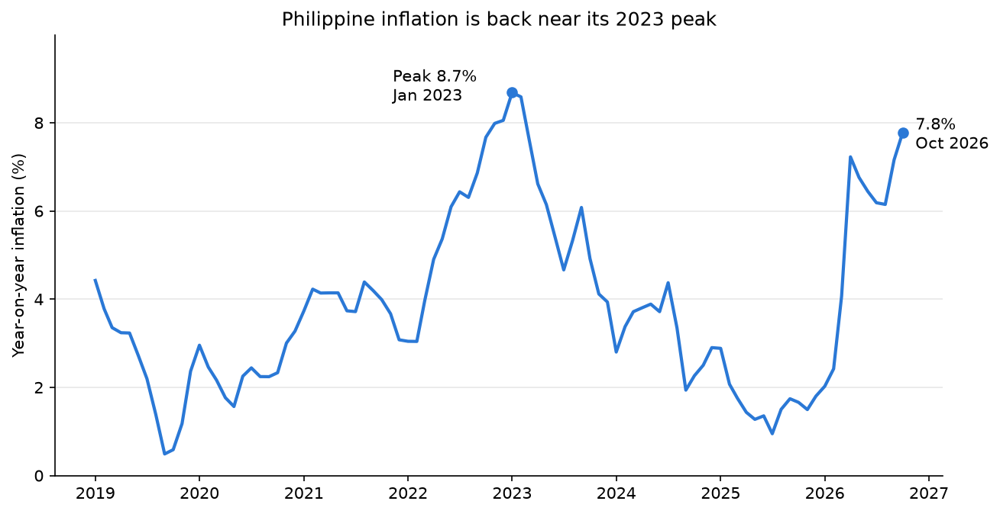
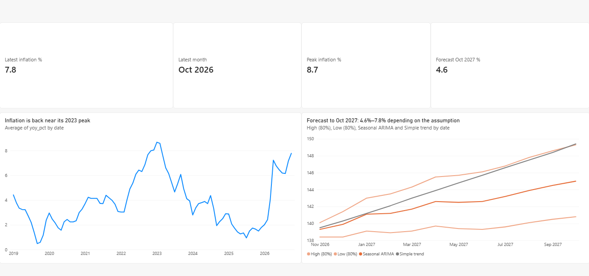
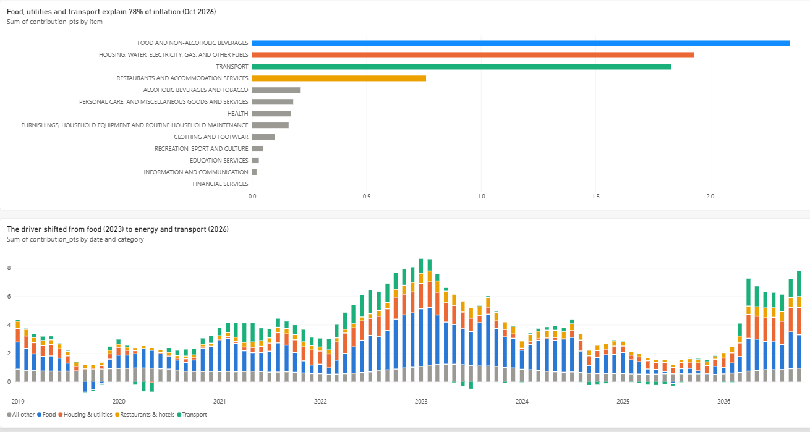
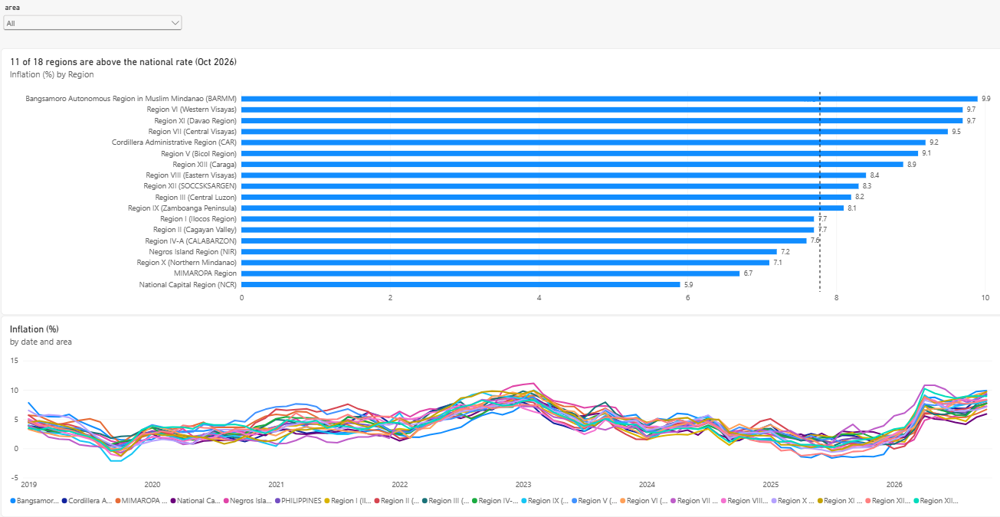
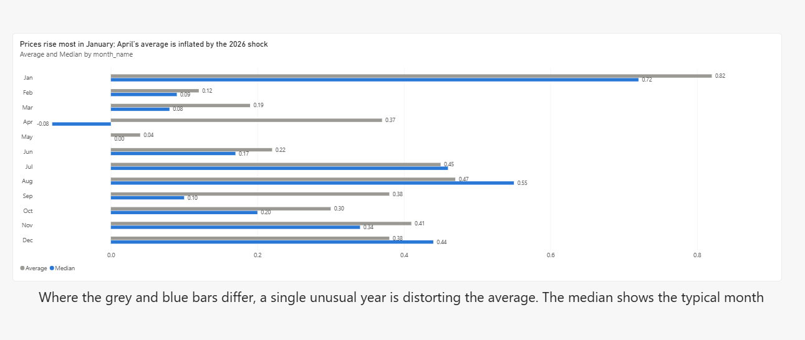
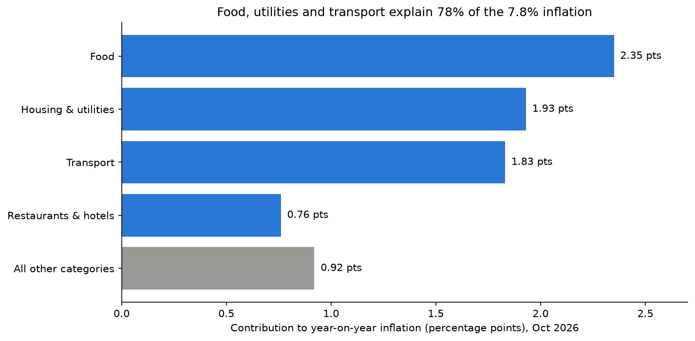
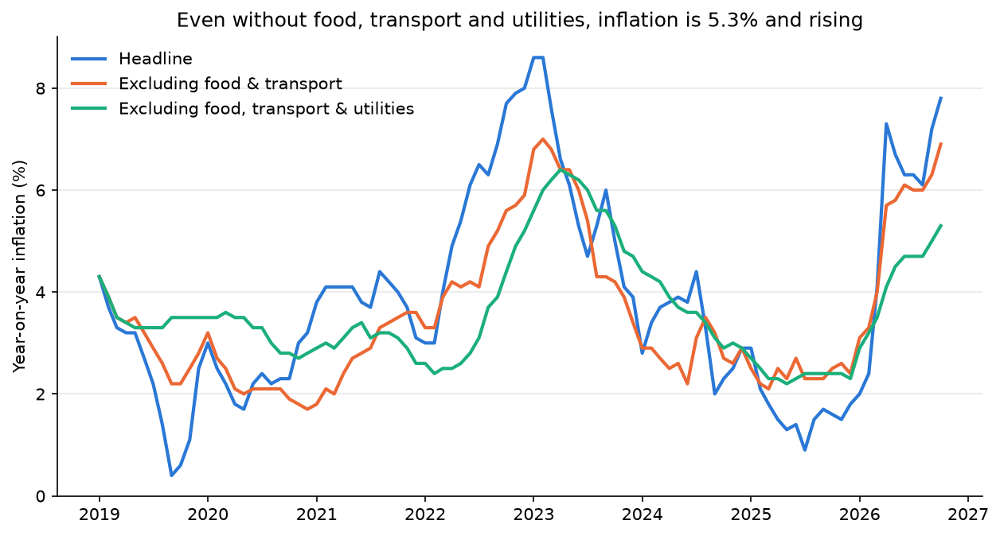
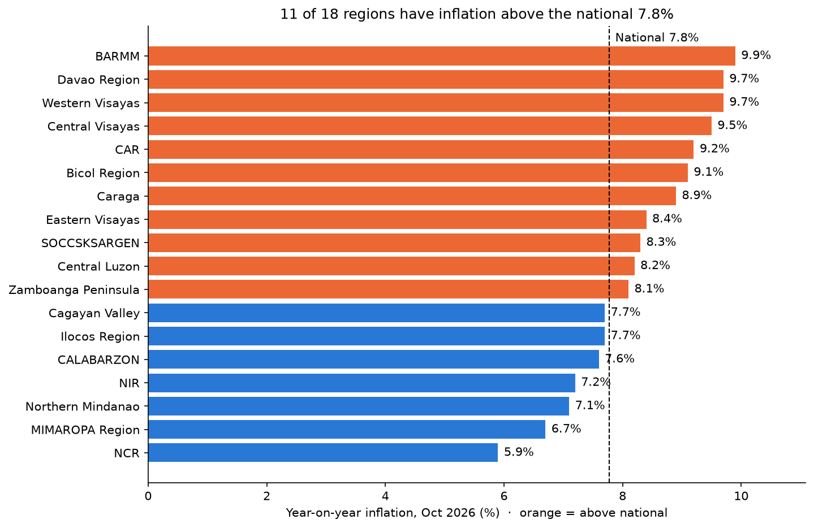
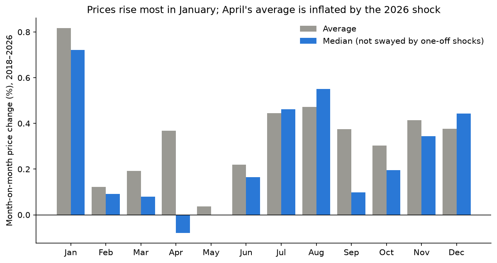
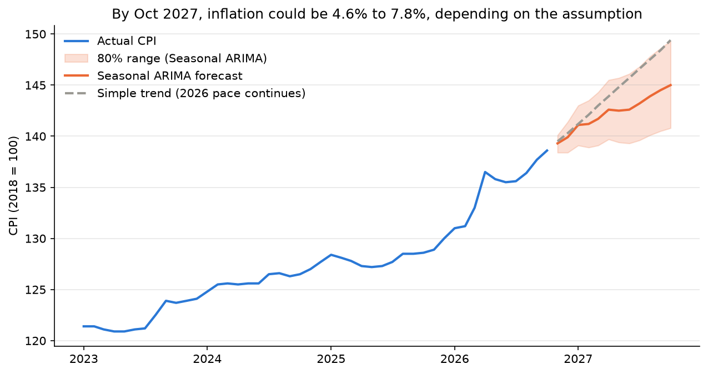

# What is driving Philippine inflation? (2019–2026)

An end-to-end analysis of the Philippine Statistics Authority's Consumer Price Index (CPI):
from messy official CSVs to a validated SQLite database, SQL analysis, a statistical forecast and an interactive Power BI dashboard.

**Tools:** Python (pandas, matplotlib, statsmodels) · SQLite · SQL (CTEs, window functions, conditional aggregation) · Power BI (DAX)



---

## Summary

Philippine inflation reached **7.8% in October 2026**, close to its January 2023 peak of 8.7%. It tripled in two months (2.4% in February → 7.2% in April 2026).

| # | Question | Answer |
|---|---|---|
| 1 | What is driving inflation? | Food, utilities and transport explain **78%** of it. The main driver shifted from **food (2023)** to **energy and transport (2026)**. |
| 2 | Is it only a fuel shock? | **No.** Excluding food, transport and utilities, inflation is still **5.3%** and rising. |
| 3 | Which regions are hit hardest? | **BARMM 9.9%** vs **Metro Manila 5.9%**. **11 of 18** regions are above the national rate. |
| 4 | Are some months always more expensive? | **January** is the dependable high month. April's high average is caused by one shock year. |
| 5 | Where is inflation heading? | Roughly **4.6%–7.8% by October 2027**, depending on the assumption. Forecasts cannot anticipate shocks. |
| 6 | Can the data be trusted? | Yes, at national level: all checks pass. Detailed provincial item data is thin (structural gaps). |

---

## Interactive Power BI dashboard

Four pages built on the pipeline's output CSVs (`outputs/`). When new data arrives, `python run_all.py` + **Refresh** in Power BI updates everything.

| Overview | Drivers |
|---|---|
|  |  |

| Regions | Seasonality |
|---|---|
|  |  |

File: `ph_inflation_dashboard.pbix`. Features: DAX measures (latest rate, peak, forecast), a region slicer, a dynamic national reference line, custom month sort order.

---

## Question 1: What is driving inflation?

**Why it matters:** "Inflation is 7.8%" doesn't say what to fix. The policy response to a food shock (rice supply, imports) is different from an energy shock (fuel, power rates).

**How I solved it:**
- Each category's **contribution** = its share of household spending (weight) × its price change, divided by last year's all-items CPI, so the 13 pieces add up to headline inflation.
- SQL: `JOIN` CPI with weights, `LAG(cpi, 12)` with `PARTITION BY` category for the year-ago price → `sql/05_contribution.sql`.
- Over time with conditional aggregation (`SUM(CASE WHEN …)`) → `sql/07_contribution_history.sql`.
- **Validated:** the 13 contributions add up to the headline rate in all 94 months (mean gap 0.04 pp, max 0.12 pp) → `sql/06_validate_contribution.sql`.

**Result:**
- Food (2.35 pts), housing & utilities (1.93) and transport (1.83) = **78%** of the 7.8%.
- Food is #1 even though its prices rose **less** than average (6.1%), because it is **38%** of household spending. Transport prices rose 20.1% but it is only 9% of spending.
- **The cause changed:** in January 2023 food added 4.06 points (a food crisis). In October 2026 transport's contribution nearly doubled and utilities is #2 (an energy shock).



---

## Question 2: Is the surge only fuel, or is it broad-based?

**Why it matters:** a fuel-only shock fades when oil prices calm down. A broad rise lasts longer.

**How I solved it:**
- Rebuilt the CPI as a weighted average of the 13 category indices, then removed categories: transport; food and transport; food, transport and housing/utilities → `sql/08_headline_vs_excluding.sql`.
- Checked the method first: the rebuilt headline matches PSA's 7.8%.
- These are my own analyst-defined measures, not PSA's official core inflation.

**Result:**
- Excluding food and transport: **6.9%**. Excluding food, transport **and** utilities: **5.3%**, up from 2.4% a year earlier and still rising almost every month.
- In 2025, food and transport were holding inflation **down**. In early 2026 they flipped to pushing it up.
- In 2023, the underlying measure kept rising for about 3 months after the headline peaked: a **second-round effect** (businesses passing on costs with a delay).



---

## Question 3: Which regions are hit hardest?

**Why it matters:** the national figure hides regional differences that matter for wages, aid and pricing.

**How I solved it:**
- Year-on-year inflation per region with `LAG(cpi, 12) OVER (PARTITION BY region …)` → `sql/09_regions.sql`, full history in `sql/12_regions_monthly.sql`.
- Excluded "Areas Outside NCR", a PSA aggregate that would otherwise appear as a fake 19th region.

**Result:**
- **BARMM 9.9%** (highest) vs **NCR 5.9%** (lowest), a 4-point gap.
- **11 of 18 regions are above the national 7.8%.** The national figure is pulled down by Metro Manila's large weight.
- BARMM swung from **deflation in 2025** to the **highest inflation** in 2026.



---

## Question 4: Are some months always more expensive?

**Why it matters:** families and businesses can plan for predictable price rises, and forecasts must account for them.

**How I solved it:**
- Month-on-month change with `LAG(cpi, 1)`, grouped by calendar month with `strftime('%m')` → `sql/10_seasonality.sql`.
- Compared **average vs median** (pandas, since SQLite has no median), and re-ran without 2026 to test the result.

**Result:**
- **January** is the dependable high month (+0.82% average, +0.72% median). July–August and December also rise.
- April's average (+0.37%) is inflated by the 2026 shock. Its median is **−0.08%**, and excluding 2026 its average is 0.08%.



---

## Question 5: Where is inflation heading?

**Why it matters:** forecasts are only useful if you know how accurate they are.

**How I solved it:**
- Two models: a **simple trend** (last 12 months' pace continues) and a **Seasonal ARIMA** on log CPI → `forecast.py`.
- **Rolling backtest:** forecast from 35 starting months (Dec 2022 – Oct 2025) and measure the error 1, 3, 6 and 12 months ahead.

| Months ahead | 1 | 3 | 6 | 12 |
|---|---|---|---|---|
| Seasonal ARIMA | 0.38% | 0.84% | 1.36% | 2.41% |
| Simple trend | 0.39% | 0.78% | 1.23% | 2.68% |

**Result:**
- The two models perform about the same. ARIMA is slightly better only at 12 months.
- A forecast made in October 2025 **missed the 2026 energy shock completely** (error grew to −5.7%). No price-based model can foresee external shocks.
- **Forecast for October 2027: 4.6% (Seasonal ARIMA, 80% range shown) to 7.8% (2026 pace continues).**



---

## Question 6: Can the data be trusted? (data quality)

**How I checked it:**

| Check | Result |
|---|---|
| Recomputed year-on-year inflation vs PSA's published figures (`sql/03_validate_yoy.sql`) | All **94** months match within rounding (max gap 0.049 pp) |
| National category weights add up to 100% (`sql/04_weights_check.sql`) | 13 categories, total **100.0** |
| Category contributions add up to headline inflation (`sql/06_validate_contribution.sql`) | Max gap **0.12 pp** over 94 months |
| Dashboard numbers vs SQL/Python results | Match (7.8%, 8.7%, 4.6%) |

**Missing data:** 19.5% of cells in the raw CPI file are empty (`..`). Most of it is **structural, not random**:
- Nov–Dec 2026 are not yet published (100% empty).
- In every published month the same **~17.4%** of cells are empty: detailed items that are not priced in some provinces.
- Gaps are concentrated in small or remote provinces (Davao Occidental, City of Isabela, Sulu, Basilan, Tawi-Tawi, Batanes), so regional comparisons use all-items CPI only.

Missing values are dropped, never filled in.

---

## How it works

```
PSA OpenSTAT CSVs (wide, title row, '..' for missing)
   │  clean.py    skip title row · reshape wide → long · numbers & dates · split labels
   ▼
SQLite database: cpi · yoy_published · weights
   │  sql/        12 queries: analysis + validation
   ▼
export.py → outputs/*.csv → Power BI dashboard
charts.py → images/        forecast.py → backtest + 12-month forecast
```

| File / folder | What it does |
|---|---|
| `explore.py` | First look at the raw file: structure and missing data |
| `clean.py` | Cleans the 3 PSA files and builds `data/processed/ph_cpi.db` |
| `sql/` | 12 SQL queries: analysis and validation checks |
| `export.py` | Runs the SQL files and saves dashboard tables to `outputs/` |
| `charts.py` | Charts 1–5 (reads the saved SQL files directly) |
| `forecast.py` | Backtest, forecast and chart 6 |
| `run_all.py` | Runs everything in order with one command |
| `ph_inflation_dashboard.pbix` | Power BI dashboard |

## Run it yourself

1. Download from [PSA OpenSTAT](https://openstat.psa.gov.ph/) (Price Indices, 2018-based) and place in `data/raw/`:
   - Consumer Price Index for All Income Households by Commodity Group
   - Year-on-Year Changes of the CPI by Commodity Group
   - Weights by Commodity Group for CPI
2. `pip install -r requirements.txt`
3. `python run_all.py`
4. Open `ph_inflation_dashboard.pbix` and click **Refresh**.

## Limitations

- The "excluding" measures are my own calculation, not PSA's official core CPI.
- Weights are fixed at 2018 spending shares, so contributions drift slightly from the headline.
- Forecasts use past prices only and cannot anticipate external shocks (oil prices, typhoons, policy changes).

*Data: Philippine Statistics Authority, OpenSTAT. Analysis by Mark Jerome.*